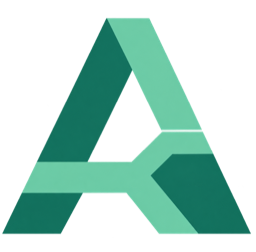
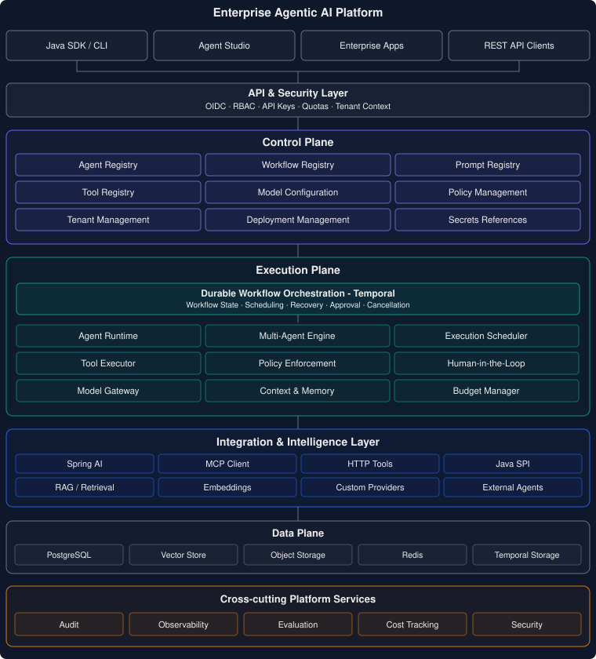

<p align="center"></p>

# Enterprise Agentic AI Platform

A self-hosted Java platform for running AI agents and workflows. Publish an immutable agent version, start it in Studio and follow its execution through model calls, tool use and human approvals. Temporal resumes the workflow after worker restarts. PostgreSQL stores run state, usage and audit records.

[Quickstart](#start-locally) · [Java SDK](docs/developer-guide/java-sdk.md) · [Examples](#examples-and-interfaces) · [Architecture](#architecture) · [Contributing](CONTRIBUTING.md) · [Apache 2.0](LICENSE)

## Start locally

Clone the repository and enter the project directory.

```sh
git clone https://github.com/AgilAghamirzayev/enterprise-agentic-ai-platform.git
cd enterprise-agentic-ai-platform
```

### Run an agent with the SDK

With JDK 21 installed, build the example and pass it a name. It prints `Hello, Ada!`.

```sh
./mvnw -pl examples/hello-agent -am package -DskipTests
java -jar examples/hello-agent/target/hello-agent-0.1.0.jar Ada
```

### Run Studio and the worker

Install JDK 21 and Docker with Compose 2.24.4 or later. The Maven wrapper downloads Maven on first use. The default model is a deterministic echo provider, so the quickstart works offline after downloading dependencies and images.

```sh
./scripts/init-local.sh
./mvnw --batch-mode --no-transfer-progress verify
docker compose up --build -d --wait
```

On macOS with multiple JDKs, set `JAVA_HOME` using `export JAVA_HOME=$(/usr/libexec/java_home -v 21)`. The local initialization script creates a private `.env` with unique credentials. It preserves an existing configuration.

Open [Agent Studio](http://localhost:13000). Choose **Local account**. Sign in as `admin` using the generated `PLATFORM_LOCAL_PASSWORD`. Use `reviewer` and `PLATFORM_REVIEWER_PASSWORD` for approval decisions. The API listens on [localhost:18080](http://localhost:18080/actuator/health). The Compose bindings are loopback-only. Set `PLATFORM_API_PORT` or `PLATFORM_STUDIO_PORT` to resolve a port conflict.

1. In **Agents**, save the supplied YAML as `hello-agent` version `1.0.0`. Select **Validate and publish**.
2. Open **Playground**, select the published version and enter `"Hello from Studio"` as JSON input.
3. Start the execution. The detail panel displays the completed steps and result. Open **Audit** to inspect the corresponding events.
4. In **Workflows**, paste an example definition to try parallel execution or a human approval. Each published version is immutable. Save changes under a new version.

To stop the local services and keep your data, run `docker compose stop`.

## Architecture

The control plane publishes versioned agent and workflow definitions. The execution plane runs those versions on Temporal workers and records results in PostgreSQL.

[](docs/architecture/platform-architecture.svg)

The diagram includes optional infrastructure such as Redis and object storage. The [architecture comparison (Azerbaijani)](docs/architecture/design-comparison.az.md) lists implementation status and test coverage for each part of the design.

### Components

| Component | Responsibility |
| --- | --- |
| Domain, SPI, SDK, application engine | Typed Java contracts, local execution, cancellation, limits and model/tool interfaces |
| Spring Boot starter, Spring AI adapter, testkit, BOM | Agent discovery, typed model output, provider integration and deterministic testing |
| Plan compiler | Validates YAML or JSON graphs, immutable references, bounded fan-out, permissions and execution limits |
| Platform Server | REST and SSE, OIDC, version publication, run admission, dispatch, governance and evaluations |
| Platform Worker | Durable workflows, model routing, retrieval, tool authorization, human review and execution recovery |
| PostgreSQL store | Liquibase migrations, tenant RLS, transactional outbox, artifacts, memory, pgvector, usage and audit |
| Connector library | Versioned, tenant-bound REST and MCP tools, approved REST writes and projected responses |
| Agent Studio | Next.js workspace for developers, operators, reviewers and auditors |

PostgreSQL owns definitions, artifacts and the API read model. Temporal owns orchestration history. The API commits each accepted run and its dispatch record together. Retried delivery uses the same workflow ID. The worker stores outputs by execution and step so a retry can reuse committed results. Provider requests can recur after an ambiguous network outcome. Usage reservations cover individual attempts.

## Examples and interfaces

| Workflow | Code or definition |
| --- | --- |
| Standalone Spring Boot SDK agent | [Hello agent](examples/hello-agent/) |
| Single model call | [Hello model](examples/hello-model/definition.json) |
| Model-selected, allowlisted Java tool | [Custom tool agent](examples/custom-tool-agent/definition.json) |
| Document answer with citation IDs | [RAG agent](examples/rag-agent/definition.json) |
| Supervisor routing, parallel specialists and join | [Multi-agent supervisor](examples/multi-agent-supervisor/definition.json) |
| Action-bound approval and idempotent write | [Approval workflow](examples/approval-workflow/definition.json) |
| Invoice variance with threshold and exception approval | [Accounting workflow](examples/enterprise-accounting/) |
| Read-only external MCP tool | [MCP integration](examples/mcp-integration/README.md) |
| Planning, evaluation loops and scheduled events | [Workflow patterns](docs/developer-guide/workflow-patterns.md) |

Install the SDK with `./mvnw -pl platform-bom,agent-spring-boot-starter,platform-testkit -am install`. Learn how to add your first handler in the [SDK guide](docs/developer-guide/java-sdk.md). The [plan reference](platform-plan/README.md) documents supported node types and limits.

The API serves its generated OpenAPI document at `GET /api/v1/openapi`. Local writes use HTTP Basic and the header `X-Platform-Client: studio`. Production clients use an OIDC bearer token. A run requires an `Idempotency-Key`. The server returns HTTP 202 with the execution ID and links. Use `GET /api/v1/runs/{id}/events` for SSE and `Last-Event-ID` to resume within retained audit history.

## Models and knowledge

Set `PLATFORM_MODEL=openai`, `OPENAI_BASE_URL`, `OPENAI_MODEL` and `OPENAI_API_KEY` to use an OpenAI-compatible provider. A published model profile may select an operator-approved fallback. Provide prices in USD per million input and output tokens to enforce monetary budgets. Without prices, a USD ceiling fails closed. Pricing, model allowlists and execution quotas are independent controls.

The local knowledge provider uses lexical hashing and PostgreSQL full-text rank. For learned semantic retrieval, configure the same embedding provider, dimensions and revision on API and worker, then index the documents for that revision. See the [knowledge ingestion guide](docs/operator-guide/knowledge-ingestion.md). Dataset and report contracts are in the [evaluation guide](docs/developer-guide/evaluations.md).

## Agent traces in Langfuse

With JDK 21 and Docker running, use the following command to start the local platform with Langfuse and verify a Studio execution.

```sh
./scripts/verify-langfuse.sh
```

Open an execution in Studio and select **View trace in Langfuse**. The trace connects run submission, the Temporal activity and the model attempt. Each generation reports its model and token usage. The collector excludes prompt and response content. See the [Langfuse operator guide](docs/operator-guide/langfuse.md) for sign-in, sampling and production configuration.

## Verification

```sh
docker compose --profile verification run --rm smoke
docker compose --profile verification run --build --rm browser-test
```

The smoke suite creates synthetic, uniquely versioned resources in the local tenant. It exercises publication, run idempotency, deterministic inference, RAG citations, policy denial, human approval, multi-agent execution and cancellation. The browser suite signs in, publishes a YAML agent, executes it and checks the result. Additional browser tests cover reviewer access on mobile, workspace membership, audit search and the authorization-code flow against a disposable OIDC issuer. For a full build and both suites, use `./scripts/verify.sh` with JDK 21 and Docker running.

For cluster deployment, supply PostgreSQL with pgvector, a Temporal namespace and an OIDC issuer. Configure a public OIDC client to use browser SSO with PKCE. The [operator guide](docs/operator-guide/kubernetes.md) covers Helm values and deployment prerequisites. The [release guide](docs/operator-guide/release.md) covers local artifact and SBOM generation. The embedded Temporal service in Compose is intended for development.

## Project and community

This is the 0.1.0 development line. Local verification covers PostgreSQL, Temporal, browser sign-in, Studio executions and an optional self-hosted Langfuse instance. Production identity providers, paid model routes, restore procedures and cluster capacity need verification in the target deployment.

The [roadmap](ROADMAP.md) describes the current scope and open integration work. Architectural decisions are recorded in the [decision log](docs/adr/README.md). Deployment-specific identity and tool contracts are covered in the [workspace guide](docs/operator-guide/workspaces-and-tools.md).

Read the [contribution guide](CONTRIBUTING.md) to propose a change and the [code of conduct](CODE_OF_CONDUCT.md) before participating. Report vulnerabilities through the [security policy](SECURITY.md). The project is distributed under the [Apache License 2.0](LICENSE).
