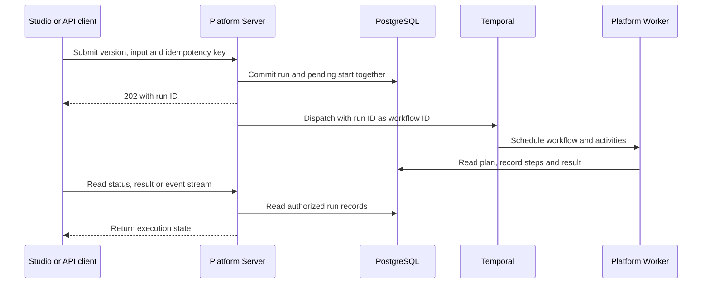

# What happens to an agent run?

A published definition identifies the code or plan to execute. A run identifies one invocation of that version. A step identifies work within the run. Keep the version when reproducing behavior and the run ID when investigating an individual request.

### Before execution

The server resolves the authenticated tenant and workspace, checks invocation permissions and loads the published version. The run and its pending dispatch record share a database transaction. If Temporal is temporarily unavailable after admission, a client can still look up the queued run. The dispatcher retries using the same workflow ID. [Submission code](../../platform-server/src/main/java/io/agentplatform/server/RunSubmission.java) · [Dispatch code](../../platform-server/src/main/java/io/agentplatform/server/DispatchQueue.java)

### During execution

Temporal records workflow decisions and schedules activities. Activities perform external I/O, including model inference, retrieval and tool calls. The worker uses the run’s pinned plan and records completed step results so a retried activity can reuse committed work. A human approval binds a decision to a proposed action and its arguments. If the worker restarts, Temporal can replay workflow history and continue from a durable point. [Workflow implementation](../../platform-worker/src/main/java/io/agentplatform/worker/AgentRunWorkflow.java) · [Plan and node reference](../../platform-plan/README.md)

A model request can reach its provider even if the worker loses the response. Retried provider attempts can incur additional usage. A tool that writes to another system needs its own idempotency and reconciliation contract. When a write’s outcome is ambiguous, check the downstream system before resolving the platform record. [Connector contracts](../operator-guide/workspaces-and-tools.md) · [Architecture decisions](../adr/README.md)

### After execution

The API serves status, step history and results from PostgreSQL. Temporal history supports orchestration recovery. The platform audit records support inspection within the authorized scope. When tracing is enabled and a run is sampled, **View trace in Langfuse** opens its model and step observations. [Langfuse guide](../operator-guide/langfuse.md)

## Troubleshoot by symptom

| Symptom | What to check |
| --- | --- |
| Studio reports `Invalid or missing local account` | Choose **Local account**. Match `admin` with `PLATFORM_LOCAL_PASSWORD` or `reviewer` with `PLATFORM_REVIEWER_PASSWORD` from the installation you started. |
| Publishing returns HTTP 412 | Another edit changed the revision. Reload the draft, review it, then validate and publish with its current revision. |
| Starting a run returns HTTP 409 | Check whether the same actor reused an idempotency key with a different request. Recover the original run using the original body and key. |
| The run stays `QUEUED` | Check `docker compose ps`, the API readiness endpoint and `docker compose logs --tail=100 server worker temporal`. In Kubernetes, confirm the worker polls the configured Temporal namespace and task queue. |
| The timeline shows `approval.requested` and progress pauses | Open **Approvals** as an eligible reviewer in the same workspace. Match the run ID, inspect the tool and arguments, then decide before the deadline. |
| The run ends with `DENIED` or `BUDGET_EXCEEDED` | Check the execution steps and audit events for the affected action. Review the version’s allowed tools, role requirements, invocation limits and applicable quotas. |
| A result request returns HTTP 409 | Read the run status first. For a failed or denied run, inspect steps and audit events. |
| No Langfuse link appears | Check that Studio has the project URL and that this run was sampled. A linked trace can take a few seconds to appear after ingestion. |

[Local Studio walkthrough](../tutorials/studio.md) · [Production deployment](../operator-guide/kubernetes.md) · [Documentation home](../README.md)
